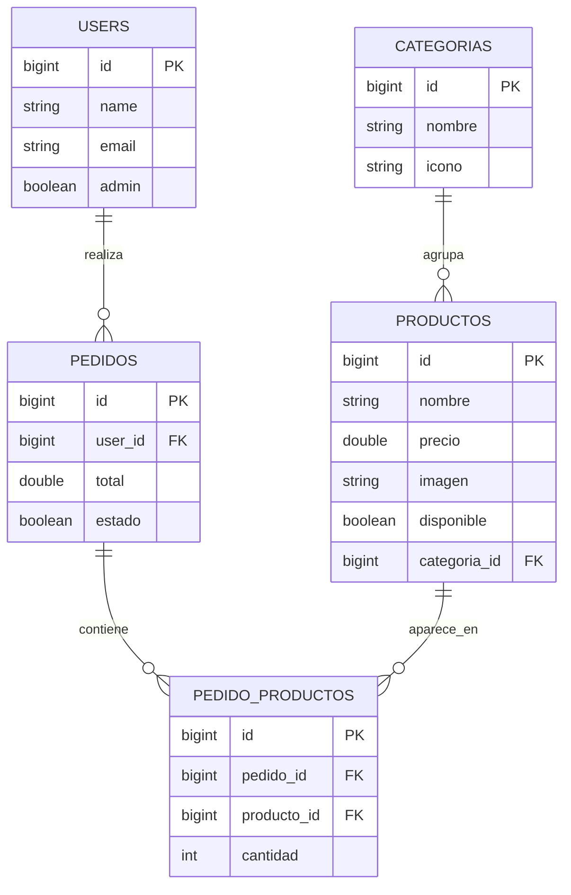
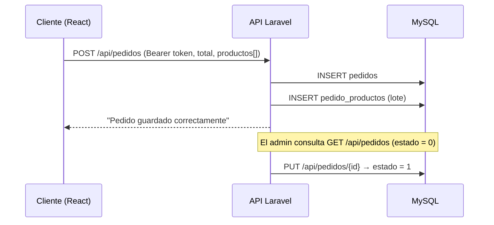

<p align="center"><a href="https://laravel.com" target="_blank"></a></p>


<h1 align="center">Quiosco — API</h1>

<p align="center">
  API REST para un quiosco de comida, hecha con Laravel 13 y Sanctum.
</p>

<p align="center">
  
  
  
  
</p>

---

API REST para un quiosco de comida: catálogo de categorías y productos, pedidos de clientes y gestión de pedidos por un administrador. Backend del proyecto [Quiosco-React-FrontEnd](https://github.com/carlos-dev23/Quiosco-React-FrontEnd).

## Funcionalidades

- Autenticación con **Laravel Sanctum** (tokens Bearer): registro, login y logout.
- Listado de categorías y productos (con API Resources).
- Creación de pedidos con sus productos y cantidades (tabla pivote).
- Listado de pedidos pendientes y marcado como completado.
- Marcar un producto como no disponible.
- Usuarios con bandera `admin`.

## Stack

PHP 8.3 · Laravel 13 · Laravel Sanctum 4 · MySQL · Eloquent · Form Requests · API Resources

## Endpoints

| Método | Ruta | Auth | Descripción |
|---|---|---|---|
| POST | `/api/registro` | No | Crea usuario y devuelve token |
| POST | `/api/login` | No | Devuelve token y usuario |
| POST | `/api/logout` | Sanctum | Revoca el token actual |
| GET | `/api/user` | Sanctum | Usuario autenticado |
| GET | `/api/categorias` | No | Lista de categorías |
| GET | `/api/productos` | No | Lista de productos |
| PUT | `/api/productos/{id}` | No* | Marca el producto como no disponible |
| GET | `/api/pedidos` | Sanctum | Pedidos pendientes con usuario y productos |
| POST | `/api/pedidos` | Sanctum | Crea un pedido con sus productos |
| PUT | `/api/pedidos/{id}` | Sanctum | Marca el pedido como completado |

\* Ver "Siguientes pasos".

## Modelo de datos



## Flujo de un pedido



## Instalación

```bash
git clone https://github.com/carlos-dev23/Quiosco-Laravel-API.git
cd Quiosco-Laravel-API
composer install
cp .env.example .env
php artisan key:generate
# configura DB_* en .env (por defecto: base backend_quiosco)
php artisan migrate --seed   # carga categorías y productos de ejemplo
php artisan serve
```

## Siguientes pasos

- Proteger las rutas de administrador (actualizar productos / pedidos) con un middleware o Policy basado en `users.admin`.
- Validar el pedido con un Form Request y envolver la creación en una transacción.
- Pruebas Feature con Pest (auth, creación de pedido) y CI con GitHub Actions.
- Restringir `allowed_origins` de CORS al dominio del frontend en producción.del frontend en producción.urced software licensed under the [MIT license](https://opensource.org/licenses/MIT).
